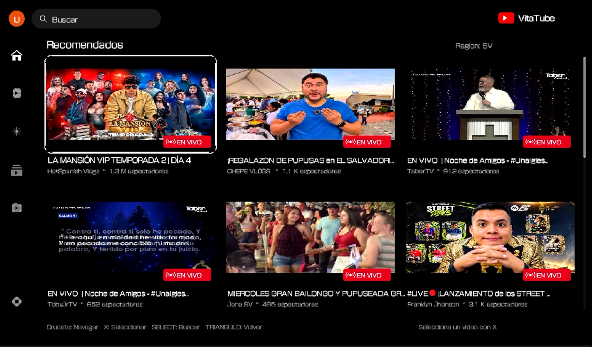
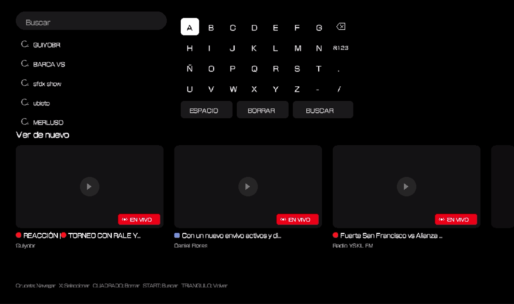
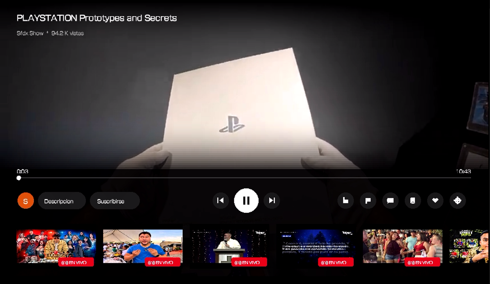
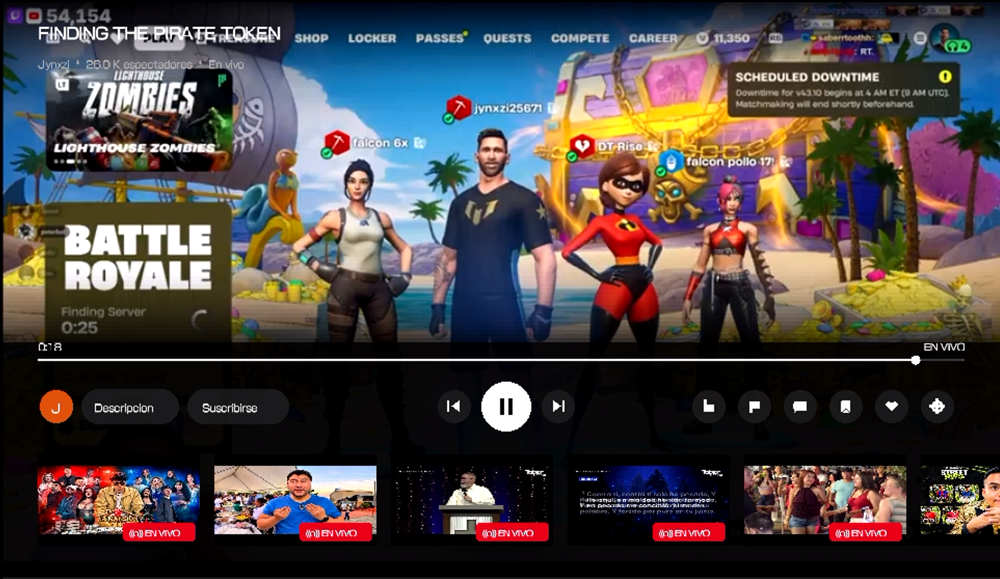
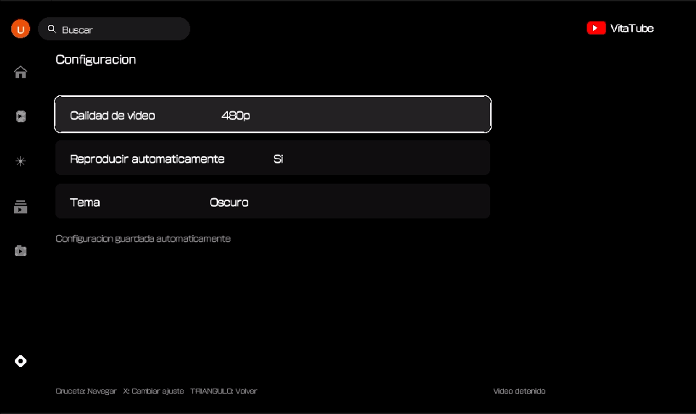

# VitaTube

Un cliente homebrew de YouTube para PlayStation Vita escrito en C. Permite explorar tendencias, realizar búsquedas con sugerencias en vivo y reproducir tanto videos bajo demanda como transmisiones en directo directamente en la consola mediante `libmpv` y `FFmpeg` acelerados por GXM sobre `vita2d`.

> Proyecto homebrew no oficial, sin fines de lucro y sin afiliación con YouTube ni Google. Utiliza un servidor de Piped y un extractor configurados para consultar el catálogo y enviar el streaming de video hacia la consola.

| Inicio |
|---|


| Búsqueda | Reproductor |
|---|---|
|  |  |

| Directos (En vivo) | Configuración / Biblioteca |
|---|---|
|  |  |


---

## Características

- **Reproducción de videos y directos en PS Vita:** renderizado en pantalla completa (`960×544`) con `libmpv` (backend GXM) y `FFmpeg` integrado en `vita2d`. Detecta transmisiones en directo (`EN VIVO`), muestra espectadores y ajusta por defecto la calidad a `480p` en directos para mantener la fluidez.
- **Selector de calidad y autoplay:** permite elegir calidad máxima (`240p`, `360p`, `480p`, `720p`) tanto desde Configuración como al vuelo dentro del reproductor, además de activar/desactivar la reproducción automática.
- **Búsqueda estilo TV con sugerencias en tiempo real:** teclado en pantalla (`ABC` y `&123`), autocompletado en vivo mientras escribes e historial de las últimas 5 búsquedas guardadas.
- **Secciones integradas:**
  - **Inicio** y **Tendencias** con carga de miniaturas en segundo plano.
  - **Biblioteca** con historial persistente de videos reproducidos (con opción para vaciarlo).
  - **Configuración** para calidad y autoplay.
  - **En desarrollo:** **Shorts**, **Suscripciones** y la pantalla de inicio de sesión / registro con Piped (actualmente solo cuentan con la interfaz base y aún no cargan el feed de suscripciones).
- **Interfaz híbrida (botones + táctil):** control completo con D-pad y botones, soporte táctil frontal (navegación, barra de progreso, pausa y carrusel de relacionados) y desplazamiento con el panel táctil trasero.
- **Retroalimentación sonora:** efectos de audio de navegación, selección y cancelación sintetizados por `sceAudioOut`.

---

## Cómo funciona

```text
Interfaz vita2d (C, src/ui/)
   ├── Catálogo / Búsqueda / Sugerencias    ──▶  Servidor Piped
   ├── Obtención de stream (H.264 / MP4)    ──▶  Extractor de streams (respaldo vía Piped)
   └── Reproducción (src/player/)           ──▶  libmpv (GXM) + FFmpeg + SceVideodec/AvPlayer
```

- **Metadatos y navegación:** VitaTube consulta un servidor de **Piped** previamente configurado para obtener tendencias, resultados de búsqueda, sugerencias y miniaturas. La pantalla de inicio/registro en Piped ya existe como base de interfaz, pero la carga de suscripciones sigue pendiente de implementación.
- **Streaming de video:** cuando seleccionas un video o directo, la app solicita el flujo compatible con la consola a un **extractor** configurado para enviar el streaming hacia la PS Vita (con respaldo de Piped si el extractor no responde), descargando y reproduciendo el flujo progresivamente mediante el protocolo interno `vts://` y `libmpv`.
- **Rendimiento en consola:** asigna `192 MB` de heap (`_newlib_heap_size_user`), `2 MB` de stack para hilos de decodificación (`_pthread_stack_default_user`) y configura frecuencias de trabajo de fábrica (`444 MHz` CPU, `222 MHz` GPU/Bus, `166 MHz` Xbar).

### Estructura del proyecto

| Ruta | Descripción |
|---|---|
| `CMakeLists.txt` | Configuración de compilación con CMake y VitaSDK (`VTTB00001`) |
| `src/main.c` | Punto de entrada, configuración de heap, stack y frecuencias |
| `src/app.c` | Bucle principal, lectura de controles y ciclo de vida de módulos |
| `src/audio.c` | Síntesis y reproducción de efectos de sonido en `sceAudioOut` |
| `src/log.c` | Sistema de logs en `ux0:data/VitaTube/vitatube.log` y `debugnet` |
| `src/ui/home.c` | Interfaz gráfica, teclado de búsqueda, menú lateral y overlay del reproductor |
| `src/youtube/youtube.c` | Cliente Piped (tendencias, búsqueda, sugerencias, configuración y base de sesión) |
| `src/youtube/history.c` | Persistencia del historial de reproducción (`history.dat`) |
| `src/network/http.c` | Cliente HTTP/HTTPS con `SceHttp` y `SceSsl` |
| `src/network/stream_api.c` | Comunicación con el extractor para obtener la URL de stream |
| `src/network/cJSON.c` | Parser JSON integrado |
| `src/player/video_player.c` | Reproductor basado en `libmpv` GXM, streaming en segundo plano y control de reproducción |
| `assets/` | Ícono y recursos del LiveArea empaquetados en el `.vpk` |
| `build/vita-media/` | Cabeceras (`include/`) y librerías estáticas (`lib/`) de `libmpv` y `FFmpeg` para Vita |
| `deploy.sh` | Script auxiliar para compilar y enviar el binario a la consola por FTP |

---

## Instalación y uso

1. Descarga o compila `VitaTube.vpk`.
2. Instala el `.vpk` en tu PS Vita usando **VitaShell**.
3. Conecta la PS Vita a una red Wi-Fi e inicia **VitaTube**.
4. Navega por **Inicio** o **Tendencias**, abre la búsqueda con `Select` o el buscador superior, y consulta tu historial en **Biblioteca**.

---

## Controles

### Navegación general

| Entrada | Acción |
|---|---|
| D-pad | Mover foco por tarjetas, barra lateral y opciones |
| Cruz (`×`) | Reproducir video / entrar a sección / cambiar ajuste |
| Triángulo (`△`) | Volver / cerrar resultados de búsqueda o teclado |
| Cuadrado (`□`) | Borrar historial (en Biblioteca) / borrar carácter (en búsqueda) |
| `Select` | Abrir pantalla de búsqueda |
| `Start` | Confirmar búsqueda (en teclado) / salir de VitaTube |
| Táctil frontal | Abrir barra lateral (deslizar derecha), ocultarla (deslizar izquierda), cambiar fila (deslizar arriba/abajo), tocar búsqueda o perfil |
| Táctil trasero | Deslizar arriba/abajo para desplazar las filas de videos |

### Reproductor

| Entrada | Acción |
|---|---|
| D-pad | Moverse entre barra de progreso, barra de botones y carrusel de relacionados (y `±10 s` en la barra de progreso) |
| Cruz (`×`) | Mostrar controles (si están ocultos) o activar botón / pausar y reanudar |
| Círculo (`○`) / Triángulo (`△`) | Cerrar menú superpuesto o detener video y volver al catálogo |
| Cuadrado (`□`) | Mostrar u ocultar los controles en pantalla |
| `L` / `R` | Retroceder / adelantar `10 s` |
| Táctil frontal | Tocar el video para pausar/reanudar, tocar la barra de progreso para saltar al tiempo deseado, o tocar botones y relacionados |

---

## Compilación

### Requisitos previos

1. **[VitaSDK](https://vitasdk.org)** instalado y con la variable de entorno `VITASDK` configurada (`CMakeLists.txt` requiere `$ENV{VITASDK}/share/vita.cmake`).
2. **CMake** `>= 3.16`, `make` (o Ninja) y el toolchain `arm-vita-eabi-gcc`.
3. **Dependencias precompiladas del repositorio** en `build/vita-media/` (ya incluidas en el repo y enlazadas directamente por `CMakeLists.txt`):
   - `libmpv` con soporte de renderizado **GXM** (`mpv/render_gxm.h`, `libmpv.a`).
   - `FFmpeg` para Vita (`libavcodec.a`, `libavfilter.a`, `libavformat.a`, `libavutil.a`, `libswresample.a`, `libswscale.a`).
4. **Puertos y librerías de VitaSDK** (instalables con `vdpm` / incluidos en VitaSDK):
   - `vita2d`
   - `libass` (`ass`), `harfbuzz`, `fribidi`, `freetype`
   - `libarchive` (`archive`), `bzip2` (`bz2`), `zstd`, `libpng` (`png16`), `zlib` (`z`), `libjpeg-turbo` (`jpeg`)
   - `debugnet`, `pthread`, `m` y stubs del sistema `Sce*` (`SceVideodec`, `SceAudiodec`, `SceCodecEngine`, `SceGxm`, `SceAppMgr`, `ScePgf`, `SceCommonDialog`, `SceDisplay`, `SceCtrl`, `SceTouch`, `SceAudio`, `ScePower`, `SceSysmodule`, `SceIofilemgr`, `SceNet`, `SceHttp`, `SceSsl`, `SceLibKernel`, `SceProcessmgr`).

### Generar el `.vpk`

Desde la raíz del proyecto (en un entorno donde `VITASDK` esté cargado, como Linux, WSL, MSYS2 o contenedor Docker con VitaSDK):

```bash
cmake -B build
cmake --build build -j4
```

Al finalizar se generarán `build/VitaTube.self` y `build/VitaTube.vpk`.

> **Importante:** si necesitas limpiar una compilación anterior, **no elimines la carpeta `build/vita-media/`**, ya que contiene los encabezados y librerías estáticas de `libmpv` y `FFmpeg` que `CMakeLists.txt` necesita para enlazar.

### Despliegue rápido a la consola (opcional)

El script `deploy.sh` automatiza la compilación, la transferencia de `eboot.bin` y `assets/` por FTP y el lanzamiento mediante VitaCompanion:

```bash
VITA_IP=<IP_DE_TU_PS_VITA> ./deploy.sh
```

---

## Datos, logs y solución de problemas

Todos los datos locales se almacenan en `ux0:data/VitaTube/`:

| Archivo | Propósito |
|---|---|
| `config.ini` | Calidad máxima, autoplay y configuración de endpoints activos |
| `history.dat` | Historial binario de videos reproducidos |
| `searches.txt` | Últimas búsquedas realizadas |
| `auth.token` / `auth.user` | Datos de sesión en Piped (en desarrollo) |
| `stream.mp4` | Caché temporal de descarga progresiva del video actual |
| `vitatube.log` | Log de eventos, red y errores del reproductor |

| Síntoma | Causa / Solución |
|---|---|
| Muestra `"Sin conexion; mostrando inicio local"` | Revisa que la PS Vita tenga acceso a internet y que el servidor Piped esté disponible |
| `"No se pudo obtener el stream del video"` | Ni el extractor ni el respaldo de Piped pudieron resolver un flujo compatible (H.264/MP4); revisa `ux0:data/VitaTube/vitatube.log` |
| Un directo se entrecorta | Reduce la calidad a `360p` o `240p` desde el botón de ajustes dentro del reproductor |
| Error de CMake indicando `VITASDK no esta configurado` o falta `mpv`/`avcodec` | Exporta `VITASDK` en tu shell y verifica que `build/vita-media/include` y `build/vita-media/lib` sigan presentes |

---

## Créditos y licencias

- [VitaSDK](https://vitasdk.org) y [vita2d](https://github.com/xerpi/vita2d)
- [libmpv](https://mpv.io/) y [FFmpeg](https://ffmpeg.org/)
- [Piped](https://github.com/TeamPiped/Piped)
- [cJSON](https://github.com/DaveGamble/cJSON)
